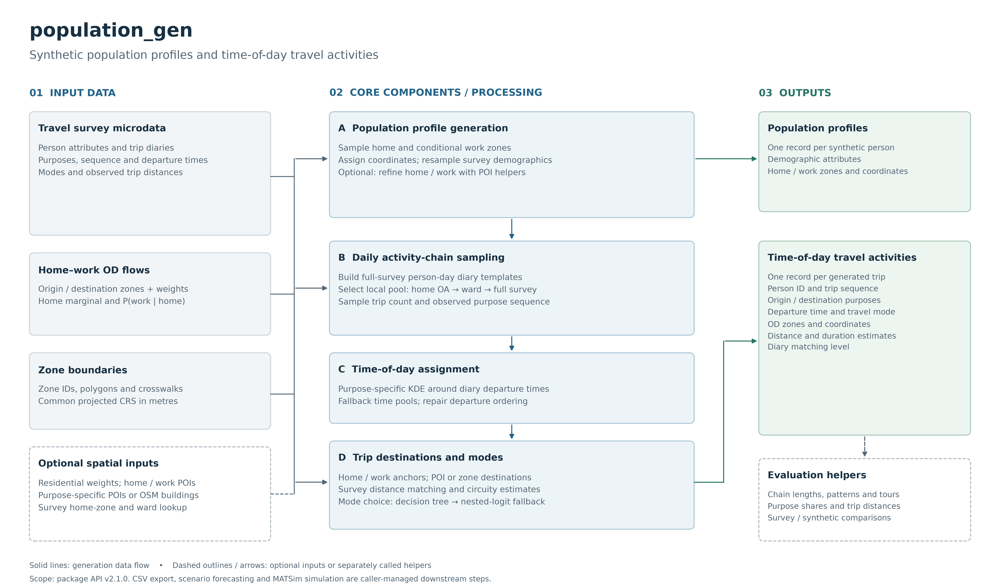

# population_gen

`population_gen` generates synthetic population profiles and daily, time-of-day travel activity chains from travel-survey records, home–work origin–destination (OD) flows, and spatial data. The current package version is `2.1.0`.

The public workflow has two stages:

1. **Population profiles:** `generate_population_profiles()` samples demographics and home/work locations.
2. **Travel activities:** `generate_travel_activities()` assigns survey-derived daily activity chains, departure times, destinations, and travel modes to those people.

Both functions return a Python `list[dict]`. File export is performed by the caller.

## Framework



[Editable vector figure](docs/population_gen_framework.svg)

The main inputs are survey microdata, weighted home–work OD flows, and zone boundaries. Optional residential weights, geographic crosswalks, and purpose-specific points of interest (POIs) refine the spatial assignments. Population profiles feed the travel-activity stage; evaluation helpers compare generated activity chains with the survey. Scenario forecasting and transport simulation are external to this package.

## Setup

Use the repository's existing Python environment and run from the directory containing `population_gen/`, or add that parent directory to `PYTHONPATH`. This directory does not currently include a standalone packaging manifest; do not assume `pip install population_gen` installs this implementation.

The code uses NumPy, pandas, GeoPandas, Shapely, and SciPy. Decision-tree mode choice also uses scikit-learn and joblib. Plotting helpers use Matplotlib. These names are taken from import statements in the source. This directory has no pinned environment file.

```python
from population_gen import generate_population_profiles, generate_travel_activities
```

## Input data

### Travel survey CSV

Provide one row per trip, including:

- A person identifier and diary day/date. The activity generator detects person columns in this order: `HHPERSONID`, `IndividualID`, `PID`, `person_id`, `PersonID`; date columns: `ODATE`, `DayID`, `TripDate`, `date`, `day`, `Date`. Person IDs must distinguish people across households.
- A trip sequence column, preferably `JourSeq` or `TRIPNO`. Other recognised names are `trip_no`, `tripno`, `TripNumber`, and `TripID`. Without one, input row order is retained within each diary.
- Departure time, default `OTimin`, in minutes from midnight; set `survey_time_col` for another column such as NTS `TripStart`.
- Origin and destination activity purposes, default `OTripPur` and `DTripPur`. Numeric purpose codes need an `activity_mapping`. Use consistent labels such as `home`, `work`, `education`, `shop`, `personal`, `leisure`, and `other`.
- Demographics selected by `survey_person_cols`, a mapping from output names to survey column names. Missing mapped columns are skipped with a warning.

Optional trip-zone IDs support observed spatial transition lookups. Set `survey_origin_col=None` and `survey_dest_col=None` when they are unavailable; this activates trip chaining, where each subsequent origin inherits the previous destination.

Fitted NTS mode and distance models read the original NTS fields in `nested_mode_choice.py` and `tree_mode_choice.py`: mode, distance, purpose, and demographic covariates. Renaming columns in the generator leaves those model fields on their original names. `TripDisIncSW` supplies survey distances in miles. `W5`, when present, supplies distance weights. A generic prepared survey can use diary modes without fitting these models.

### Home–work OD flow CSV

Provide origin-zone IDs, destination-zone IDs, and non-negative flow weights with a positive total. The defaults are `h_geocode`, `w_geocode`, and `S000` (LODES-style names). For UK OA flows, use `flows_origin_col="origin_oa"`, `flows_work_geocode_col="dest_oa"`, and `flows_weight_col="flow"`.

Home zones are sampled from the origin marginal; work zones are sampled conditionally on home. Optional `rac_path` replaces the home distribution with residential weights, configured with `rac_geoid_col` and `rac_weight_col`. The default RAC weight, `C000`, counts workers rather than all residents.

### Geography and optional spatial refinements

- Zone polygons: `census_block_shp_path`, with the zone identifier selected by `census_geoid_col`. The parameter name is historical. The UK workflow supplies OA polygons (`OA11CD`).
- **Use a common projected CRS in metres for spatial travel calculations**, for example `census_crs_target="EPSG:27700"` in Great Britain. The API defaults to `EPSG:4326`; the trip-distance calculation subtracts coordinate values directly and does not convert degrees to metres.
- Optional home/work and activity POI pools can be built using helpers in `buildings.py`. Call `assign_home_work_poi_coordinates()` separately between the two generation stages to refine home/work coordinates.
- `purpose_poi_pools` provides activity destination pools; if absent, `osm_buildings_path` can supply classified building footprints. Prebuilt pools take precedence.
- A survey household-to-home-zone lookup and home-ward identifiers enable local diary matching. Additional OA/MSOA/LAD crosswalks support POI assignment and local distance distributions.

## Example: two-stage generation

This example assumes **prepared input files**, not bundled datasets. The survey contains globally unique `IndividualID`, `DayID`, `JourSeq`, numeric `OTimin`, labelled `OTripPur`/`DTripPur`, `Age`, and labelled `mode_category`. It uses diary modes; the richer NTS mode model is described below.

```python
from pathlib import Path
import pandas as pd
from population_gen import generate_population_profiles, generate_travel_activities

data = Path("prepared_data")
out = Path("results")
out.mkdir(parents=True, exist_ok=True)

shared = dict(
    survey_path=str(data / "survey_trips.csv"),
    flows_path=str(data / "home_work_flows.csv"),
    census_block_shp_path=str(data / "oa_boundaries.shp"),
    flows_origin_col="origin_oa",
    flows_work_geocode_col="dest_oa",
    flows_weight_col="flow",
    census_geoid_col="OA11CD",
    census_crs_target="EPSG:27700",
    random_seed=42,
)

persons = generate_population_profiles(
    **shared,
    target_population=1_000,
    survey_person_cols={"Age": "Age"},
    home_jitter_m=0.0,
    work_jitter_m=0.0,
)

trips = generate_travel_activities(
    persons=persons,
    **shared,
    survey_time_col="OTimin",
    survey_origin_col=None,
    survey_dest_col=None,
    continuous_start_times=True,
    force_home_start_end=True,
    use_mode_choice_model=False,
)

pd.DataFrame(persons).to_csv(out / "population_profiles.csv", index=False)
pd.DataFrame(trips).to_csv(out / "travel_activities.csv", index=False)
```

For the repository's full UK/NTS scenario workflow, see `../16-generate_population.ipynb`. It prepares scenario-specific inputs, maps NTS fields, refines home/work POIs, and calls the two public functions. Those surrounding preparation and export steps are not executed automatically by the package.

## Core processing

### 1. Population profiles

`generate_population_profiles()` loads the survey, flows, and optional geography; normalises zone identifiers; builds home and conditional work distributions; and samples the requested number of people. Coordinates come from zone centroids with optional jitter or polygon sampling. Demographic rows are sampled from the survey with replacement.

Defaults include `target_population=22200`, `batch_size=5000`, and 100 m home/work jitter. Batching does not stream the returned result: all profiles are accumulated in memory. Without polygons, home/work coordinates are NaN.

### 2. Survey preparation and activity chains

The travel generator recodes purposes and modes and builds filtered survey data for several supporting models. **Complete diary templates and continuous departure-time pools are extracted from the full survey.** The filtered subset is used for those supporting models.

For each person, diary selection uses home OA, then ward, then the full survey pool when local coverage is below `min_zone_templates=5`. It samples a trip count and a compatible observed person-day. This step resamples observed diaries. The legacy Gibbs/Markov synthesizer remains in the repository as an older path (`generator_v1.py`, `markov.py`).

### 3. Time-of-day assignment

With `continuous_start_times=True` (default), purpose-specific empirical time pools are smoothed using Gaussian kernel density estimation (KDE). Sampling prefers observations near the template time, then an AM/PM slice, then the full purpose pool. Ordering is repaired when needed, subject to daily time bounds.

With continuous sampling disabled, the generator uses template times, then purpose-specific time bins when enabled, with a random-time fallback. `time_bin_size=10` sets the width of the binned distributions. Ordering repairs use `min_trip_gap_minutes=5.0`. A repaired day can still contain departures less than five minutes apart.

### 4. Spatial destinations and travel measures

Home/work activities use the assigned person anchors, with special handling for secondary work destinations. Other activities can use purpose-specific POIs matched to survey trip-length distributions, including LAD-specific pools where available and distance-decay fallbacks. Without POI pools, assignment uses available survey/flow/zone lookups and fallback logic.

`force_home_start_end=True` requests home-based tour endpoints; its default is `False`. Trip chaining is activated when usable survey OD identifiers are unavailable.

Distances are straight-line coordinate differences. For projected coordinates, a circuity factor converts that length to an estimated network distance. Travel duration equals that distance divided by `default_speed_ms=13.89`, one speed for every trip. Routing engines and mode-specific speeds sit outside this calculation.

### 5. Mode choice

With `use_mode_choice_model=True` (default), the generator attempts an NTS-trained decision tree, then nested logit if the tree fit is unavailable or fails. Predictors include demographic characteristics, household vehicles, trip distance, purpose, and previous mode. If model sampling fails, diary modes and purpose-conditional mode shares provide fallbacks.

`mode_mapping`, `mode_nests`, and `mode_reference` configure the alternatives. `mode_choice_cache_path` controls model caching; the tree cache is named `nts_tree_mode_choice.joblib` beside that path. Nested-logit runs can refine alternative-specific constants against survey mode shares. Inspect fit diagnostics and use a fresh cache when changing inputs or model definitions.

## Transport personas

`personas.py` adds the DfT transport personas (9 segments, `transport-personas-pack.pdf`). Activity chains and destinations then differ by persona, and personas are placed by residential density.

1. **Classify survey people.** `build_persona_model(cpca_trips, region_trips)` scores every NTS person with a naive-Bayes classifier. The score uses the pack's segment profiles: age, sex, mobility difficulty, household income, car ownership, children, urban/rural, economic status, and living alone. Segment priors are calibrated to the pack's published size bands. People under 16 inherit their household's modal adult persona.
2. **Learn density profiles.** Each persona's home-density distribution supplies `P(persona | density decile)`. A persona with fewer than `min_cpca_persons` CPCA people takes its density profile, demographics, diaries, and destination lengths from the wider East of England survey. `extract_region_survey` writes `nts7553_trips_east_england.csv`.
3. **Assign personas spatially.** `assign_personas_to_persons(persons, model, density_by_oa, rng, survey_person_cols)` draws each synthetic person's persona from their home-OA density and redraws survey demographics from that persona's adults. `density_by_oa_from_cells` reads the 1 km raster. Density is rank-matched (`match="quantile"`) because the raster and NTS density scales differ. Use `"absolute"` for the raw values.
4. **Persona-specific activities.** Pass `persona_map=model.persona_map()` (adults only) and `persona_fallback_survey_path` to `generate_travel_activities`. A person who carries a `persona` key samples a diary from that persona: home OA, then ward, then the persona-wide pool. Local pools are used when they hold at least `persona_min_zone_templates` diaries. Destination lengths and decay packs also come from that persona. Omit `persona_map` and this step is unchanged. `survey_match_level` reports `oa`, `ward`, or `persona`.

The pack's attitudinal traits are not on the NTS file, so the classifier uses the structural profiles above. Segment 6 mobility and segment 9 income statistics are partly illegible in the PDF and were interpreted. Synthetic people are drawn from commute-flow origins. Retiree personas (for example segment 7) have no work trips, and the flow file therefore supplies little commute travel for them.

## Outputs

**Population profiles: one dictionary per synthetic person**

- `synthetic_person_id`, `household_id`, `person_id`.
- `home_geoid`, `work_geoid`, `home_lon`, `home_lat`, `work_lon`, `work_lat`.
- Requested demographic attributes present in the survey.

**Travel activities: one dictionary per generated trip**

- Person identifiers and `trip_sequence` (starting at 1).
- `OTripPur`, `DTripPur`, `OTimin` (minutes from midnight), and `OTIME` (`HH:MM:SS`).
- Origin/destination zone columns, normally `O_GEOID20` and `D_GEOID20`; configured survey zone names can also become output keys.
- `OLON_RANDOM`, `OLAT_RANDOM`, `DLON_RANDOM`, `DLAT_RANDOM`.
- `mode_category`, `survey_match_level` (`oa`, `ward`, or `global`), home/work zone IDs, and copied person attributes.
- `trip_distance` (coordinate units; metres only with a metric CRS), `trip_distance_network_m` (estimated, for projected coordinates), and `trip_duration` (seconds when the distance is in metres).

Coordinate column names retain `lon`/`lat` even when values are projected eastings/northings. Preserve CRS metadata alongside exported CSV files. MATSim plan export, route assignment, and transport simulation sit outside this package.

## Evaluation

`activity_eval.py` provides survey/synthetic preparation, chain-length and chain-pattern comparisons, tour types, home-endpoint checks, purpose shares, distance summaries, and plotting helpers. Useful entry points include `prepare_nts_trips`, `prepare_synthetic_trips`, `compare_chain_lengths`, `compare_chain_patterns`, `compare_tour_types`, `chain_home_flags`, `purpose_share_table`, and `distance_summary`.

Compare departure-time distributions by purpose, home/work spatial distributions, mode shares, missing coordinates, and distance distributions before downstream use. Run the helpers after generation. A population counts as checked only after those helpers have been run.

## Scope and limitations

- Demographics are resampled from **trip rows**, so frequent travellers can be represented more often. Census demographic calibration and joint household reconstruction are left to the caller.
- `household_id` and within-household `person_id` use a fixed group size of two. Shared-household relationships and a shared home coordinate are outside this assignment.
- A work anchor is generated for each profile. Employment status does not enter that step.
- Diary templates require at least one trip. Zero-trip days are outside this workflow.
- Missing spatial coverage can trigger fallback assignments. Check coverage logs and the resulting coordinates: a fallback can replace an original OD constraint.
- Departure order is repaired inside the day. Activity duration and schedule feasibility are outside that repair. Clipping near midnight can still create ties.
- Use positive population sizes and non-empty usable survey, flow, and template pools. Returned profiles and trips remain in memory.

## Source guide and legacy code

- `generator.py`: current two-stage generation and internal diary/location helpers.
- `data_io.py`: input loaders and spatial probability lookups.
- `time_stratified.py`: activity time distributions and continuous time sampling.
- `buildings.py`: POI/building pools and spatial sampling.
- `tree_mode_choice.py`, `nested_mode_choice.py`, `mode_spec.py`: mode models and mode definitions.
- `circuity.py`: approximate straight-line/network distance conversion.
- `activity_eval.py`, `eval.py`: evaluation and plots.
- `generator_v1.py`, `markov.py`, `empirical_resampling.py`: older generation paths and supporting implementations.

`QUICKSTART.md` describes the older `generate_population_stream()` workflow and is retained as historical documentation. Current package-root exports are defined in `__init__.py`. Use the two-stage API above for new work. `load_survey_csv`, `load_flow_csv`, `prepare_flow_lookup`, and `MarkovChainSynthesizer` were package-root imports in the old README. Current exports in `__init__.py` omit those four names.
